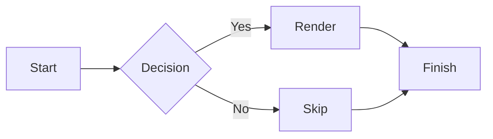

# Windows 7 compatibility check

This document exercises the core viewer on Windows 7 SP1. Every feature used
here relies on Direct2D/DirectWrite 1.0 or plain Win32, so it must render on
a Windows 7 machine with no additional installs. Features that need Direct2D
1.1 (print/PDF export, color emoji, SVG images) degrade gracefully there.

## Rendering checklist

| Check | Expectation |
| :--- | :--- |
| Startup | Window opens without a "procedure entry point" error |
| Headings | # to ### sizes differ, theme colours apply |
| Tables | Columns align, hover copy button appears |
| Lists | Nested bullets and numbered lists indent |
| Emphasis | **Bold**, *italic*, ~~struck~~ and ==highlight== differ |
| Links | Live links are clickable; missing ones show as faded ghosts |
| Quotes | Block quotes keep their tint and spacing |
| Code | Fenced blocks scroll; inline code stays literal |
| Math | $x^2$ inline and $$\frac{a}{b}$$ display render from the math font |
| Mermaid | The flowchart below draws with boxes and arrows |

> A quote with **bold**, *emphasis*, `inline code`, a [link](#rendering-checklist),
> and $a^2+b^2=c^2$. The whole block must keep its tint and indentation.

- Nested list, first level.
  - Second level, still indented.
    1. Numbered item inside a bullet.
    2. Another numbered item.

| Feature | Windows 10 | Windows 7 SP1 |
| :--- | :---: | :---: |
| Reading, editing, themes, search, tabs | Yes | Yes |
| Print / PDF export | Yes | With Platform Update (KB2670838) |
| SVG images | Yes | Alt text only |
| Color emoji | Yes | Fallback glyphs |

## Math

Inline math $E = mc^2$ and display math:

$$
\int_0^\infty e^{-x^2} dx = \frac{\sqrt{\pi}}{2}
$$

## Mermaid



## Code

```cpp
int main() {
    // Windows 7 renders fenced code with the code font and syntax colours.
    return 42;  // 2.5 MB exe, no web engine
}
```

Final paragraph: all surrounding content stays visible, including this line.
